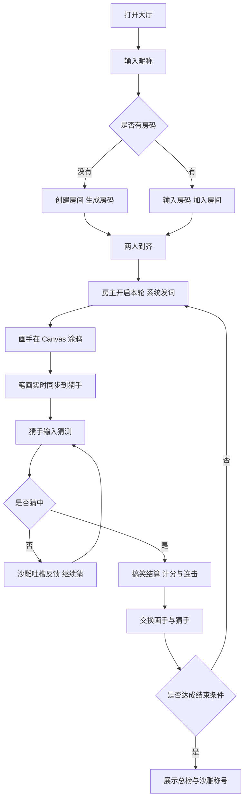

# 涂鸦乱猜 DoodleRiot · 产品需求文档

## 1. 产品概述

**涂鸦乱猜 DoodleRiot** 是一款面向两个人的实时搞怪「你画我猜」网页游戏：一人用马克笔瞎画，另一人抓耳挠腮地猜，猜中即触发夸张爆笑结算。

- **要解决的问题**：无聊时刻两个人找不到一个「打开就能玩、零门槛、够沙雕」的小游戏；传统你画我猜要么要装 App，要么要三个人以上。
- **目标用户**：想一起摸鱼/破冰的两个人（情侣、同事、室友、朋友）。
- **产品目标**：打开两个标签页（或两台设备）即可开玩，30 秒内进入第一轮，靠无厘头词库和搞怪反馈让人「笑着再来一局」。

## 2. 核心功能

### 2.1 用户角色

| 角色 | 进入方式 | 核心权限 |
|------|----------|----------|
| 房主（先创建房间的人） | 大厅起名后点「开房」 | 生成房间码、开启第一轮、换词、推进回合 |
| 房客（输房间码加入的人） | 大厅起名后输码点「加入」 | 参与轮换、绘制、猜词、触发结算 |

> 说明：一局中两人**轮流**扮演「画手」与「猜手」，每轮结束交换角色，所以两个角色都会用到，非固定。

### 2.2 功能模块

1. **大厅页（Lobby）**：搞怪标题、起名、创建房间、输码加入、玩法三连图、沙雕标语跑马灯
2. **游戏房间页（Room）**：画板 Canvas、猜词输入、回合状态栏、倒计时、计分与连击、搞笑结算弹层、聊天吐槽气泡

### 2.3 页面详情

| 页面名称 | 模块名称 | 功能描述 |
|----------|----------|----------|
| 大厅页 | 搞怪标题区 | 「涂鸦乱猜」超大标题带涂鸦贴纸与手绘箭头，背景柠檬黄 + 随机墨点/星星贴纸漂浮 |
| 大厅页 | 起名卡片 | 输入昵称（占位随机沙雕默认名），选择角色小鸡贴纸头像 |
| 大厅页 | 创建房间 | 点「开一张画布」生成 4 位房间码，展示大号房间码与「复制房码」按钮，等待伙伴加入时显示搞怪等待文案轮播 |
| 大厅页 | 加入房间 | 输入 4 位房码点「加入」，码错误时抖动 + 搞笑报错（"这码像是隔壁老王的"） |
| 大厅页 | 玩法三连图 | 三张手绘风卡片说明：① 抽到词条 ② 画手狂涂 ③ 猜手狂猜，配夸张插画式排版 |
| 大厅页 | 沙雕标语 | 顶部跑马灯循环播放无厘头标语，可点击换一条 |
| 游戏房间页 | 回合状态栏 | 显示第 N 轮、谁在画、谁在猜、当前分数、连击数、倒计时进度条 |
| 游戏房间页 | 画板 Canvas | 柠檬黄画布 + 粗黑马克笔，支持调色板（黑/红/蓝/绿/白）、笔刷粗细、橡皮、清空、撤销；画手落笔实时同步给猜手 |
| 游戏房间页 | 词条区 | 画手可见本轮搞怪词条（如「会跳广场舞的西兰花」），猜手仅见词条字数提示（●●●●）与分类提示 |
| 游戏房间页 | 猜词输入 | 猜手输入猜测并发送，命中即触发结算；未命中给沙雕吐槽（"这画的是个啥？？"）；支持「跳过」 |
| 游戏房间页 | 吐槽气泡区 | 双方可发搞怪表情/快捷吐槽（😂 🤔 💀 🔥），以气泡形式飘出 |
| 游戏房间页 | 搞笑结算弹层 | 猜中后弹出：爆炸贴纸、本轮用时、得分与连击加成、随机沙雕评语，倒计时结束自动交换角色 |
| 游戏房间页 | 角色等待态 | 当对方在画/在猜时，本页展示「TA 正在狂画中…」等搞怪动效，避免冷场 |

## 3. 核心流程

**主流程**：进入大厅 → 起名 → 房主开房拿到房码 → 伙伴输码加入 → 房主开启第一轮 → 系统发词（画手可见）→ 画手狂涂、笔画实时同步 → 猜手边看边猜 → 猜中触发结算与计分 → 交换角色 → 进入下一轮 → 分数累计，达成目标分或玩够局数后出总榜。

## 4. 用户界面设计

### 4.1 设计风格

- **主色**：明亮柠檬黄 `#FFE14D`（页面底）与 `#FFD60A`（强调块）；**点缀色**：番茄红 `#FF5A5F`、电光蓝 `#2E9BFF`、薄荷绿 `#31D07A`（仅用于小面积贴纸与反馈）
- **描边与阴影**：全站**黑色粗描边**（2–4px，`#141414`）+ **硬投影**（`4px 4px 0 #141414`），营造新粗野主义 / 贴纸涂鸦质感
- **按钮风格**：胶囊或圆角矩形贴纸按钮，默认硬投影，`hover` 上移、`active` 下沉（投影收缩），点击有「啪」的物理感
- **字体**：标题使用搞怪手写体 `ZCOOL KuaiLe`（站酷快乐体）；正文使用 `Noto Sans SC`；数字/分数用等宽加粗增强游戏感
- **布局风格**：非对称、略带旋转的贴纸式卡片堆叠，大量手绘箭头、墨点、星形涂鸦作为装饰，允许轻微「乱」以强化沙雕感
- **图标/emoji 风格**：lucide-react 线性图标（粗描边）+ 原生 emoji 混用，夸张直白

### 4.2 页面设计概览

| 页面名称 | 模块名称 | UI 元素 |
|----------|----------|---------|
| 大厅页 | 搞怪标题区 | 超大 `ZCOOL KuaiLe` 标题带 2–3 度旋转与黑色描边；背景漂浮随机旋转的星形/墨点贴纸（CSS 关键帧）；顶部跑马灯标语 |
| 大厅页 | 起名与开房卡 | 白色贴纸卡 + 硬投影；输入框粗描边、聚焦变柠檬黄；主按钮番茄红、次按钮白底黑边；房码以大号等宽数字 + 虚线分隔展示 |
| 大厅页 | 玩法三连图 | 三张倾斜卡片交错排列，序号用大号圆贴纸，hover 时轻微回正并放大 |
| 游戏房间页 | 回合状态栏 | 顶部固定条：轮次徽章、画手/猜手头像贴纸、分数大字、连击火苗、倒计时进度条（黄→红渐变） |
| 游戏房间页 | 画板 Canvas | 圆角粗边框画布，柠檬黄底；左侧竖排工具贴纸（颜色圆点、粗细、橡皮、撤销、清空）；落笔为圆头粗线 |
| 游戏房间页 | 猜词与吐槽 | 底部输入条粗边框；吐槽快捷按钮为大号 emoji 贴纸；气泡从底部飘出并淡出 |
| 游戏房间页 | 结算弹层 | 全屏半透明黄幕 + 中心爆炸星形贴纸；分数滚动增长；随机沙雕评语；「再来一轮」贴纸按钮 |

### 4.3 响应式

桌面优先设计：宽屏时画板居中、工具栏左置、状态栏横排；平板/手机自适应为上下布局（状态栏在上、画板居中、工具与输入在下），画布按容器等比缩放，触点按 44px 最小热区优化，颜料工具改为横向可滚动的贴纸条。

### 4.4 3D 场景说明

不适用（本项目为 2D 涂鸦风格，无 3D 场景）。
