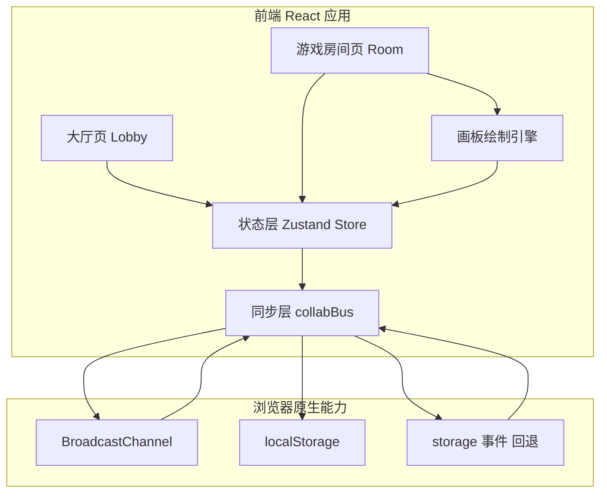
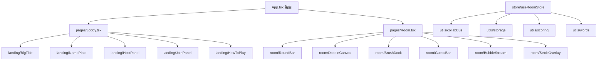
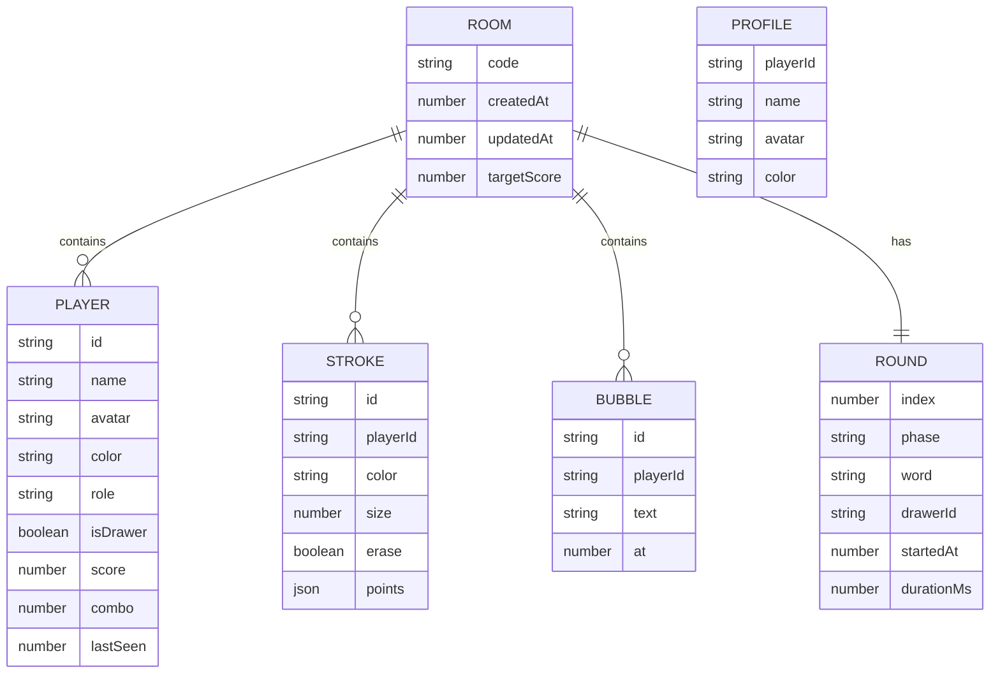

# 涂鸦乱猜 DoodleRiot · 技术架构文档

## 1. 架构设计

本项目为**纯前端**应用，无后端、无数据库。双人实时同步复用浏览器原生能力实现：同一浏览器多标签页之间使用 `BroadcastChannel` 通信（不可用时回退到 `localStorage` + `storage` 事件）；房间状态持久化在 `localStorage`，作为「真相来源 + 断线恢复」。



## 2. 技术说明

- **前端**：React@18 + TypeScript + tailwindcss@3 + vite
- **脚手架**：vite-init（模板 `react-ts`）
- **后端**：无
- **数据库**：无（使用 `localStorage` 承担房间状态持久化）
- **状态管理**：zustand
- **路由**：react-router-dom
- **动画**：framer-motion（页面转场、结算弹层、贴纸入场）+ 原生 CSS 关键帧（漂浮贴纸、跑马灯、抖动）
- **绘板**：原生 Canvas 2D（`pointerdown/move/up` 采样为笔画点集，圆头描边绘制）
- **图标**：lucide-react
- **测试**：vitest + jsdom + @testing-library/react
- **样式工具**：clsx + tailwind-merge

## 3. 路由定义

| 路由 | 用途 |
|------|------|
| `/` | 大厅页：起名、创建房间、输码加入、玩法介绍 |
| `/room/:code` | 游戏房间页：画板、猜词、回合、计分、结算 |
| `*` | 兜底重定向到 `/` |

## 4. 通信协议定义

无后端，下列为**标签页之间的消息类型定义**（`BusMessage`），通过 `BroadcastChannel` / `storage` 广播。

```ts
/** 房间内玩家 */
export interface Player {
  id: string;            // 本标签页随机生成的稳定 id
  name: string;          // 昵称
  avatar: string;        // 贴纸头像 emoji
  color: string;         // 主题色（用于描边/气泡区分）
  role: "host" | "guest";
  isDrawer: boolean;     // 本轮是否为画手
  score: number;         // 累计分数
  combo: number;         // 当前连击
  lastSeen: number;      // 心跳时间戳，用于判定在线
}

/** 一次笔画（画板增量同步的最小单位） */
export interface Stroke {
  id: string;
  playerId: string;
  color: string;
  size: number;          // 笔刷粗细
  erase: boolean;        // 是否橡皮
  points: { x: number; y: number }[]; // 归一化坐标 0~1
}

/** 回合状态 */
export type RoundPhase = "waiting" | "drawing" | "settled" | "finished";

export interface RoundState {
  index: number;         // 第几轮，从 1 开始
  phase: RoundPhase;
  word: string;          // 本词条（仅画手可见，非画手端不渲染明文）
  hint: string;          // 分类提示
  drawerId: string;      // 本轮画手 id
  startedAt: number;     // 本轮开始时间戳
  durationMs: number;    // 本轮限时
  guessedAt?: number;    // 猜中时间戳
  guesserIds: string[];  // 已猜中的玩家
}

/** 吐槽气泡 */
export interface ChatBubble {
  id: string;
  playerId: string;
  text: string;          // emoji 或短吐槽
  at: number;
}

/** 房间整体状态（整快照，localStorage 持久化） */
export interface RoomState {
  code: string;
  createdAt: number;
  updatedAt: number;     // 合并基准：按此字段取较新者
  players: Player[];
  strokes: Stroke[];
  round: RoundState;
  bubbles: ChatBubble[];
  targetScore: number;   // 达成即结束
}

/** 标签页之间广播的消息 */
export type BusMessage =
  | { type: "hello"; player: Player; room: RoomState }        // 新标签页加入，索要快照
  | { type: "sync"; room: RoomState }                          // 整快照同步
  | { type: "stroke"; code: string; stroke: Stroke }           // 单点笔画增量
  | { type: "clear"; code: string; playerId: string }          // 清空画布
  | { type: "undo"; code: string; playerId: string; strokeId: string }
  | { type: "guess"; code: string; playerId: string; text: string }
  | { type: "bubble"; code: string; bubble: ChatBubble }
  | { type: "presence"; player: Player }
  | { type: "leave"; playerId: string };
```

## 5. 前端模块结构



## 6. 数据模型

### 6.1 数据模型定义

无关系型数据库，下列为 `localStorage` 中的存储结构。



### 6.2 存储键定义

```ts
// localStorage 键位约定
const PROFILE_KEY = "doodleriot.profile";      // 本机档案：playerId / name / avatar / color
const ROOM_KEY = (code: string) => `doodleriot.room.${code}`;  // 房间整快照
const ROOM_INDEX_KEY = "doodleriot.rooms";     // 已创建/加入的房间码列表，便于断线恢复

// 合并策略（receive("sync") 时）
// 1) 以 updatedAt 较大者为基底
// 2) players 取并集，同 id 取 lastSeen 较新者，避免互相覆盖心跳
// 3) strokes 取并集并按 id 去重，保留顺序
// 4) round 若 index 更大或 phase 更靠后（waiting<drawing<settled<finished）则以新者为准
```

## 7. 关键实现约定

- **心跳与离线**：每 2s 广播一次 `presence`；`now - player.lastSeen > 6000ms` 判定为离线，UI 显示「TA 掉线了…」。
- **笔画同步**：绘制中按节流（约每 40ms）批量广播 `stroke` 增量；新加入者通过 `hello` 索取整快照补齐历史笔画。
- **词条可见性**：`round.word` 明文仅在**画手**本地渲染；猜手端只渲染字数占位与分类提示，防止偷看（纯前端约束）。
- **回合推进**：仅房主可点击「开始 / 下一轮」推进 `round`，避免双端同时推进导致状态冲突。
- **计分规则**：基础分 100；剩余时间越多加分越高（`+ 剩余秒数 * 2`）；连击每 +1 额外 `+20 * combo`（上限 5 连）。
- **兜底**：`BroadcastChannel` 不存在时使用 `localStorage` 写入 + `storage` 事件监听实现广播，逻辑层对上层透明。
